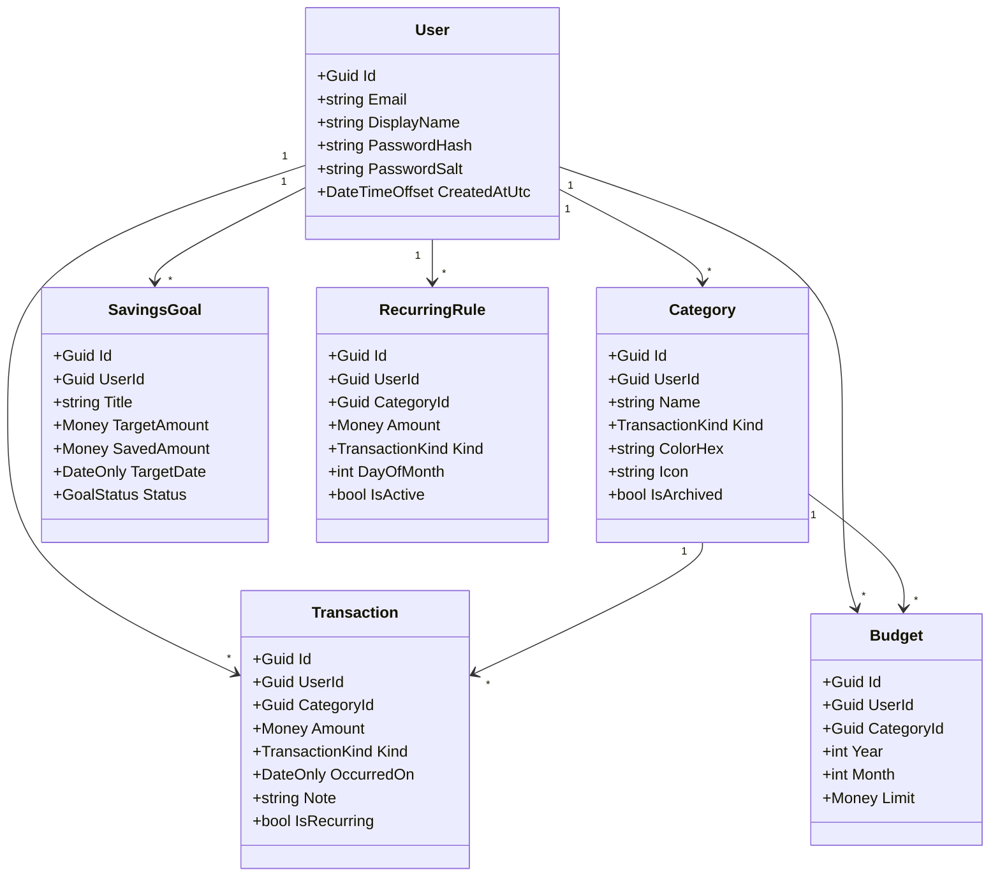
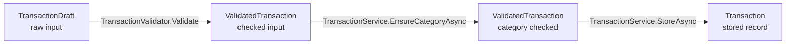
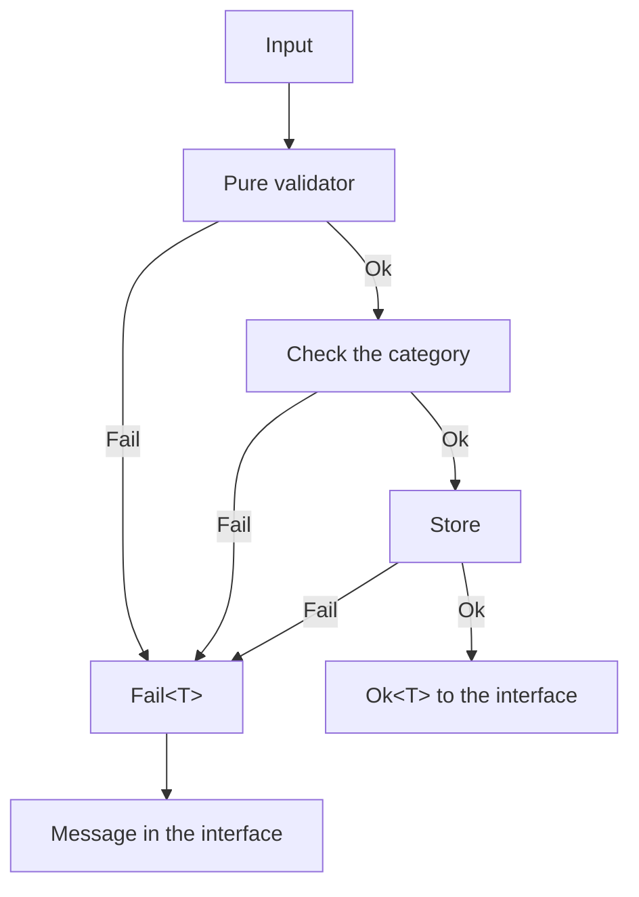
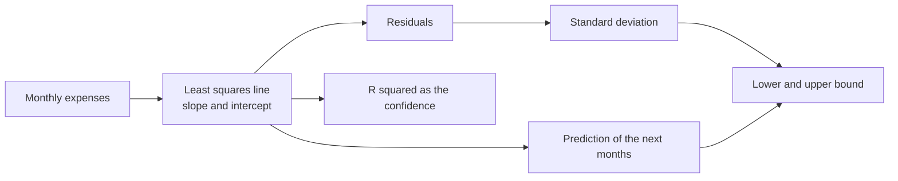
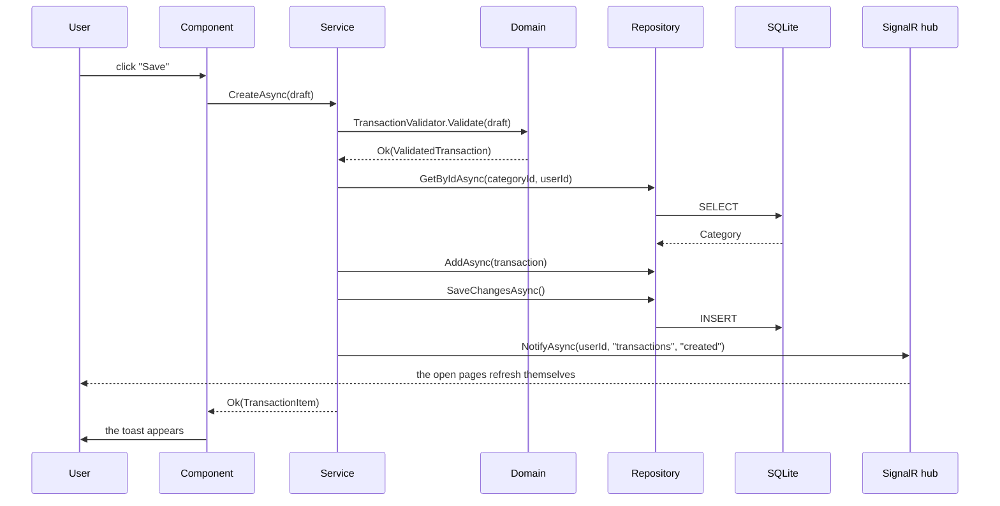

# Architecture of FinanceFlow

## 1. Layers

FinanceFlow follows the principles of **clean architecture**. The dependencies always point
inwards: the domain knows nothing, the application layer knows only the domain, the infrastructure
implements the interfaces of the application layer, and the user interface talks to the application
layer.

```mermaid
graph TD
    subgraph Presentation["FinanceFlow.Web — presentation"]
        P1[Pages]
        P2[Shared components]
        P3[State containers]
    end

    subgraph Application["FinanceFlow.Application — use cases"]
        S1[TransactionService]
        S2[BudgetService]
        S3[AnalyticsService]
        S4[ExportService]
        S5[AuthService]
    end

    subgraph Domain["FinanceFlow.Domain — business core"]
        D1[Entities (records)]
        D2[AnalyticsCalculator]
        D3[ForecastingEngine]
        D4[InsightEngine]
        D5[Validation]
        D6[Result&lt;T&gt; and Money]
    end

    subgraph Infrastructure["FinanceFlow.Infrastructure — technical details"]
        I1[EF Core repositories]
        I2[SQLite]
        I3[SignalR hub]
        I4[PBKDF2 hasher]
        I5[RecurringTransactionWorker]
        I6[Demo data seeder]
    end

    P1 --> P2
    P1 --> P3
    P1 --> S1
    P1 --> S3
    P2 --> Application
    S1 --> D1
    S1 --> D5
    S3 --> D2
    S3 --> D3
    S3 --> D4
    Infrastructure -. implements .-> Application
    Infrastructure --> Domain
    Application --> Domain
```

| Layer | May depend on | Contains |
|---|---|---|
| `FinanceFlow.Domain` | nothing | immutable records, pure functions, validators, `Result<T>`, `Money` |
| `FinanceFlow.Application` | Domain | services (use cases), read models, the interfaces of the repositories |
| `FinanceFlow.Infrastructure` | Application, Domain | EF Core, SQLite, SignalR, hashing, the clock, the worker |
| `FinanceFlow.Web` | Application, Infrastructure | Blazor components, state containers, the stylesheet, the endpoints |

**Why:** the business rules can be tested without a database, without a browser and without a web
server. The 94 unit tests of the project need nothing but the `Domain` and the `Application`
assembly.

---

## 2. The domain model



Every entity is an **immutable record**. A change is expressed with the `with` expression:

```csharp
Transaction updated = existing with { Amount = Money.FromDecimal(150m) };
```

### Money

`Money` is a `readonly record struct` that stores the amount in **cents** (`long Cents`).

```csharp
public readonly record struct Money(long Cents)
{
    public static Money FromDecimal(decimal amount) => new((long)Math.Round(amount * 100m));
    public decimal ToDecimal() => Cents / 100m;
    public static Money operator +(Money left, Money right) => new(left.Cents + right.Cents);
}
```

Why: SQLite has no exact decimal type, and `decimal` in a financial application is a source of
rounding errors. The value object makes it impossible to add a plain `double` to an amount.

---

## 3. The pipeline of a transaction (type state)

The course assignment "Handling Temporal Coupling" asked for a design in which the compiler
prevents the wrong order of the steps. FinanceFlow uses exactly this idea.



* `TransactionDraft` — what the user typed. It can hold anything.
* `ValidatedTransaction` — the result of the pure validator. Only this type can be stored.
* `Transaction` — the stored record.

The validator is a pure function:

```csharp
public static Result<ValidatedTransaction> Validate(TransactionDraft draft)
{
    Result<decimal> amount = Validation.Positive(draft.Amount, "Amount", "The amount must be greater than zero.");
    Result<string?> note = Validation.MaxLength(draft.Note, NoteMaxLength, "Note", "...");
    Result<DateOnly> date = Validation.NotInFuture(draft.OccurredOn, "Date", "The transaction date cannot be in the future.");

    ValidationBuilder builder = new ValidationBuilder().Add(amount).Add(note).Add(date);

    if (!builder.IsValid)
    {
        return builder.Failure<ValidatedTransaction>();
    }

    return new Ok<ValidatedTransaction>(new ValidatedTransaction(...));
}
```

The same pattern is used for the savings goals (`GoalDraft` → `ValidatedGoal` → `SavingsGoal`).

---

## 4. Error handling without exceptions



`Result<T>` is an abstract record with two cases:

```csharp
public abstract record Result<T>
{
    public abstract string Error { get; }
}

public sealed record Ok<T>(T Value) : Result<T>
{
    public override string Error => string.Empty;
}

public sealed record Fail<T> : Result<T>
{
    public Fail(string error) => Error = error;
    public override string Error { get; }
    public IReadOnlyList<ValidationError> Details { get; init; } = [];
    public string Code { get; init; } = "error";
}
```

The operators `Map`, `Bind`, `BindAsync`, `Match` and `Tap` build the pipelines:

```csharp
Result<ValidatedTransaction> validated = await TransactionValidator.Validate(draft)
    .BindAsync(value => EnsureCategoryAsync(userId, value, cancellationToken));

return await validated
    .BindAsync(value => StoreAsync(userId, value, cancellationToken));
```

A failure short circuits the chain, therefore a broken input can never reach the database.
Exceptions are used only for programming errors (a `null` argument, a wrong state of the
infrastructure), never for a wrong input of the user.

---

## 5. The algorithms

### 5.1 The calculator (`AnalyticsCalculator`)

All the numbers of the reports come from one pure class. It receives immutable records and
returns immutable records.

* `TotalIncome` / `TotalExpense` — a filtered `Sum` over the cents.
* `MonthlySeries` — a **dense** series: every requested month is present, even the empty ones.
  A dense series is what makes a chart readable.
* `BreakdownByCategory` — `GroupBy` + the share of every category.
* `CumulativeBalance` — the running sum over the days.
* `SavingsRate` — `(income − expense) / income`.
* `ClassifyBudgetUsage` — the state of a budget: `NotStarted`, `OnTrack`, `AlmostReached` (from
  85 %), `Exceeded` (from 100 %).

### 5.2 The forecast (`ForecastingEngine`)

The engine fits a **least squares line** through the monthly expenses and extrapolates it.



* `slope` and `intercept` come from the normal equations of the least squares method.
* The **confidence** is the coefficient of determination `R²` of the fit: a noisy history honestly
  produces a low confidence.
* The bounds are the prediction ± 1.28 standard deviations of the residuals (an interval of about
  80 %).
* The **moving average** is offered as a second, more cautious method: it reacts slower to a
  sudden change.

### 5.3 The insights (`InsightEngine`)

The engine is a set of independent rules. Every rule is a pure function of the
`InsightContext`, and the results are sorted by severity.

| Rule | Condition | Severity |
|---|---|---|
| Growing expenses | the last month is at least 15 % above the previous one | Warning |
| Shrinking expenses | the last month is at least 10 % below the previous one | Info |
| Exceeded budget | the spent amount reaches the limit | Critical |
| Almost reached budget | more than 85 % of the limit is used | Warning |
| Unusual day | a day is three times above the daily average | Warning |
| Dominant category | one category is more than half of the expenses | Info |
| Goal almost reached | more than 80 % of the target is saved | Info |
| No activity | the last transaction is at least seven days old | Info |

A new rule is a new method — the existing ones do not change.

---

## 6. The data flow of a request



---

## 7. The state of the client

Blazor Server keeps the state of one user in the *circuit*. FinanceFlow uses three state
containers, all of them follow the same pattern:

```csharp
public abstract class StateContainer<TState> : INotifyPropertyChanged
{
    public TState State { get; protected set; }     // the value is replaced, never mutated
    public event PropertyChangedEventHandler? PropertyChanged;
}
```

| Container | Content | Published with |
|---|---|---|
| `SessionState` | the signed in user | a cascading value of the type `SessionInfo` |
| `ThemeState` | light or dark | the `theme-dark` class of the root element |
| `ToastService` | the short messages | a cascading value of the type `IReadOnlyList<ToastMessage>` |

`StateCascadingValue` is a reusable component that publishes a container to the component tree
and re-renders the children when the value changes.

An important detail of Blazor: **a component is only re-rendered when one of its parameters
changes**. The `ToastHost` therefore takes the messages as a cascading parameter and not only from
the service, otherwise the messages would never appear.

---

## 8. Real time updates

```
Component (page)                Server                         Browser
     |                            |                              |
     |-- AddAsync(transaction) -->|                              |
     |                            |-- NotifyAsync(userId) ------>|
     |                            |    IHubContext.Clients      |
     |                            |      .Group(userId)         |
     |                            |      .SendAsync("dataChanged")
     |                            |                              |
     |<--------------------------- notification -----------------|
     |  LoadAsync() -> the page refreshes itself
```

The hub groups the connections by the identifier of the user, so a notification reaches exactly the
owner of the data. The client part is a small file `wwwroot/js/financeflow.js` that uses the
SignalR browser library.

---

## 9. The background worker

`RecurringTransactionWorker` is a `BackgroundService`. Once per hour it walks through the active
recurring rules and creates the transaction of the current month when it does not exist yet. The
work happens in the background, therefore the interface stays fast, and the user sees the new
transaction immediately thanks to the SignalR notification.

---

## 10. Security

| Topic | Solution |
|---|---|
| Passwords | PBKDF2 with SHA-256, 100 000 iterations, a random salt of 16 bytes per user, a constant time comparison |
| Sessions | Cookie authentication, `HttpOnly`, `SameSite=Lax`, `Secure` when the request is secure, eight hours lifetime |
| Data isolation | Every query of the repository is filtered by the identifier of the user |
| Input | Every write passes through a pure validator, the SQL is built by Entity Framework with parameters |
| XSS | Blazor escapes every value that is written into the markup |
| The sign in form | The request is made by the browser itself, the answer of the server sets the cookie |
| Real time | The hub uses the same cookie, the group of a user is only entered with a valid session |

---

## 11. What was decided against and why

| Idea | Decision |
|---|---|
| JavaScript chart library | The charts are inline SVG, calculated in C#. Fewer dependencies, works offline, no version risk |
| Blazor WebAssembly | Blazor Server keeps the business logic on the server, the browser stays thin, the application works with a weak connection |
| A separate front end (React, Vue) | One language for the whole project, the components and the services share the same models |
| A NoSQL database | SQLite with migrations is enough for the amount of data, and it needs no server |
| Throwing exceptions for wrong input | `Result<T>` makes the failure visible in the type of the method |
| A mutable entity base class | Immutable records and the `with` expression make the changes explicit |

---

# The banking module of BarsiG

> This chapter describes the module that turned FinanceFlow into BarsiG.
> The personal finance part of the project (income, expenses, budgets, analytics, forecast,
> insights, goals, export) is unchanged and described in the chapters above.

## 1. The layers

```
BarsiG.Desktop (WPF + WebView2)
        |  navigates to
        v
BarsiG.Web (Blazor Server + minimal API)      <-- one authoritative backend
        |
        v
BarsiG.Application  (use cases, Result<T>)
        |
        v
BarsiG.Domain       (pure rules: Money, ledger, interest, Totp)
        ^
        |
BarsiG.Infrastructure (SQLite, EF Core, SignalR, workers, PDF)
```

The database belongs to the **server**. The Windows application and the browser are only
two clients of the same server, they never have their own copy of the data.

## 2. The ledger

### The tables

| Table | Content |
|---|---|
| `BankAccounts` | The containers of the money: `Primary`, `Deposit`, `Reserve`, `Issuance` |
| `LedgerTransfers` | One business transaction: the kind, the two accounts, the amount, the status, the idempotency key |
| `LedgerEntries` | The immutable lines: debit or credit, the amount, the balance after the line |
| `UserSecurityProfiles` | The role, the hash of the transaction PIN, the secret of the authenticator |
| `CustomerSessions` | The sessions of the customers, written by the server |
| `LoginEvents` | The history of the sign in attempts |
| `SecurityAuditLogs` | The immutable audit of the sensitive actions |
| `Deposits` | The savings deposits and their rate |
| `DepositInterestAccruals` | The monthly interest payments, unique per deposit and month |
| `VirtualCards` | The fictional cards, only the last four digits |

### The invariants

| # | Rule | Where it is proved |
|---|---|---|
| I1 | Every committed transaction has exactly two entries with the same amount | `LedgerExecutor`, the unique index on `(TransferId, AccountId)` |
| I2 | The sum of all entries is zero, the money is only moved | `LedgerIntegrationTests.ExecuteAsync_KeepsTheTotalSupplyOfTheSimulationConstant` |
| I3 | The balance of an account is the sum of its entries | `LedgerIntegrationTests.TheStoredBalanceAlwaysAgreesWithTheLedger` |
| I4 | The rows of the ledger are never changed | the repository has no update method for the entries |
| I5 | A customer reads only his own accounts | `IBankAccountRepository.GetOwnedAsync`, the integration test of the isolation |

### The atomicity

```
await using var transaction = await _dbContext.Database.BeginTransactionAsync(ct);
try
{
    // read the two accounts with the tracked change tracker
    // check the balance
    // add the transfer and the two entries
    // write the two new balances
    await _dbContext.SaveChangesAsync(ct);
    await transaction.CommitAsync(ct);
}
catch (DbUpdateConcurrencyException)
{
    await transaction.RollbackAsync(ct);
    return Fail("The account was changed at the same time.");
}
```

* `Microsoft.Data.Sqlite` starts a transaction in the mode `IMMEDIATE`, so the writers of the
  database are serialized.
* `LedgerWriteGate` (a `SemaphoreSlim`) serializes the writes inside the process, so the
  read, the check and the write of a movement can not interleave.
* The row of the account carries a `Version` (an optimistic concurrency token), so a lost
  update is detected by the database itself.
* The unique index on `(RequestedByUserId, IdempotencyKey)` makes a repeated request safe:
  the executor returns the original transaction instead of moving the money again.

## 3. The accounts of the Demo Bank

| Account | Owner | Balance |
|---|---|---|
| `KZ00 0000 0000 0000` | the Demo Bank | the reserve, 1 000 000 ₸ by default |
| `KZ00 0000 0000 0001` | the Demo Bank | the counterpart of the issued money, negative |
| `KZ00 …` | the customer | the primary account, exactly 0 ₸ at the registration |

The administrator never edits a balance. He moves money out of the reserve with a real
ledger transaction, therefore the reserve decreases by exactly the amount the customer receives.

## 4. The interest of the deposits

```
interest = principal × rate / 12          (rounded to whole cents, half to even)
```

The payment is a ledger transfer from the reserve to the deposit account, so the total supply
of the simulation does not change. The month that was paid is stored in the deposit and in the
table `DepositInterestAccruals`, whose unique index makes a double accrual impossible.

For the demonstration, the clock of the server can be moved forward
(`POST /admin/time/advance`, only in the development environment). The worker of the interest
pays the months that passed.

## 5. The security

| Threat | The answer of the project |
|---|---|
| A wrong password | PBKDF2 with 100 000 iterations and a random salt, five attempts block the account |
| A stolen cookie | `HttpOnly`, `SameSite=Lax`, `Secure` when the connection is encrypted, the session can be terminated |
| A request of another site | The endpoints that move money need an antiforgery token, the components work inside the server |
| A repeated transfer | The idempotency key with a unique index in the database |
| Two transfers at the same time | The transaction of the database, the gate of the process and the version of the row |
| A customer who reads the data of another | Every query of an account is filtered by the identifier of the owner |
| An administrator who changes a balance | There is no such operation, only a movement of the ledger |
| A transfer without a confirmation | The transaction PIN or the password, checked by the server |

## 6. The real time

The hub `NotificationsHub` puts every client into the group of the identifier of its user.
After a committed transaction the notifier sends the event `dataChanged` to the sender and to
the receiver. The event carries only the name of the entity and the action, never a secret.

## 7. The Windows application

```
BarsiG.exe
  ├── finds a free port of the loopback interface
  ├── starts the server of the simulation inside the process
  ├── opens the interface in a control of WebView2
  └── stops the server when the window is closed
```

The extraction of the server into `Program.CreateApp` and `Program.PrepareAsync` is the only
change that the web application needed for that: the same code serves the browser and the
desktop application.