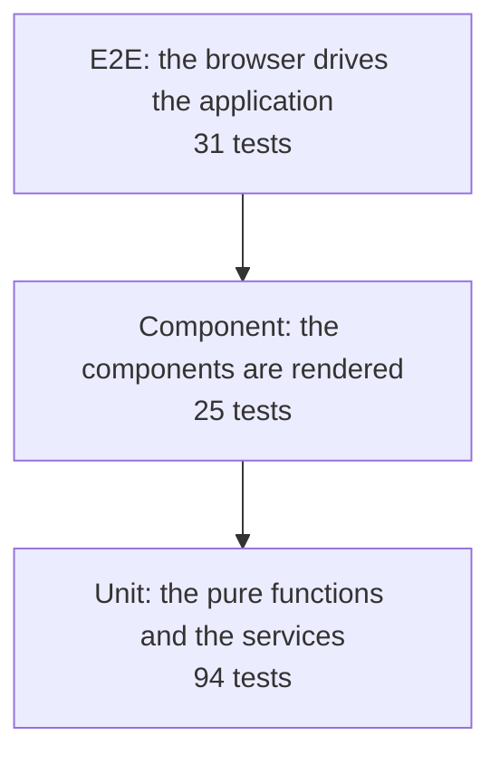

# Testing of FinanceFlow

The project has **150 automated tests** in three levels. They check the behaviour of the
application from the pure calculation up to the real browser.

| Project | Kind | Tests | Speed |
|---|---|---|---|
| `FinanceFlow.UnitTests` | Unit | 94 | 0.2 s |
| `FinanceFlow.ComponentTests` | Component (bUnit) | 25 | 0.6 s |
| `FinanceFlow.E2ETests` | End to end (Playwright) | 31 | 55 s |

---

## 1. The strategy



* The **unit tests** cover the business core: they need no database, no web server and no
  browser, so they run in milliseconds and can be written for every rule.
* The **component tests** render a real Blazor component with bUnit and check the produced markup
  and the events. They protect the reusable components from a change.
* The **end to end tests** start the real application and drive it with a real browser. They
  protect the scenarios of the user: the sign in, the navigation, the creation of a transaction,
  the export.

Every bug that was found during the development has a test that reproduces it.

---

## 2. The unit tests

`tests/FinanceFlow.UnitTests`

| File | What it checks |
|---|---|
| `MoneyTests.cs` | The conversion, the arithmetic, the comparison and the format of the amount |
| `ResultTests.cs` | `Map`, `Bind`, `BindAsync`, `Match`, `ToUnit` and the short circuit of a failure |
| `LazyOperatorsTests.cs` | `Filter`, `Transform`, `Fold`, `Head`, the deferred execution and `Function.Compose` |
| `ValidationTests.cs` | Every primitive validator and the two pipeline validators |
| `AnalyticsCalculatorTests.cs` | The sums, the monthly series, the breakdown, the running balance, the savings rate, the state of a budget |
| `ForecastingEngineTests.cs` | The growing and the shrinking trend, the bounds, the confidence, the moving average, the empty history |
| `InsightEngineTests.cs` | Every rule of the insight engine and the order of the results |
| `ServiceTests.cs` | The registration, the sign in, the transaction pipeline, the goals, the export and the password hasher |
| `Fakes/Fakes.cs` | The in memory repositories that replace the database in the tests |

The fakes are written by hand, no mocking library is needed:

```csharp
public sealed class FakeTransactionRepository : ITransactionRepository
{
    private readonly List<Transaction> _transactions = [];

    public Task<IReadOnlyList<Transaction>> GetAllAsync(Guid userId, CancellationToken cancellationToken = default) =>
        Task.FromResult<IReadOnlyList<Transaction>>(_transactions
            .Where(transaction => transaction.UserId == userId)
            .ToList());
}
```

---

## 3. The component tests

`tests/FinanceFlow.ComponentTests`

The tests render the real components and check the markup:

```csharp
[Fact]
public void ProgressBar_ClampsTheValueToOneHundredPercent()
{
    IRenderedComponent<ProgressBar> component = Render<ProgressBar>(parameters => parameters
        .Add(p => p.Value, 1.8));

    Assert.Contains("width:100%", component.Markup);
}
```

Covered are the cards, the progress bar, the money text, the badges, the empty state, the page
header, the confirmation dialog, the three chart components, the month picker, the toasts, the
icons and the geometry of the charts.

---

## 4. The end to end tests

`tests/FinanceFlow.E2ETests`

The fixture `FinanceFlowFixture`:

1. finds a free port,
2. starts the real application with `dotnet run --no-build -- --urls http://127.0.0.1:{port}`,
3. waits until the server answers,
4. starts Chromium through Playwright,
5. deletes the application and the browser afterwards.

The tests use their own database file in the temporary folder:

```csharp
startInfo.Environment["ConnectionStrings__FinanceFlow"] = $"Data Source={databasePath}";
```

The tested scenarios:

| Test | Scenario |
|---|---|
| `TheLoginPageIsShownForAnAnonymousVisitor` | A protected page redirects to the sign in |
| `AWrongPasswordIsRejected` | A wrong password shows the message |
| `TheDashboardShowsTheNumbersOfTheAccount` | The cards of the dashboard are filled |
| `TheNavigationOpensEveryPage` | All nine pages open without an error |
| `ATransactionCanBeAddedAndRemoved` | A transaction is created, shown and deleted again |
| `TheTransactionListCanBeFiltered` | The filter of the type works |
| `TheAnalyticsPageShowsTheCharts` | The charts are drawn |
| `TheBudgetsOfTheMonthAreShown` | The budgets of the month are shown |
| `TheThemeCanBeSwitched` | The dark theme is applied |
| `TheTransactionsCanBeExportedAsCsv` | The export contains the expected header |
| `TheExportIsNotAvailableForAnonymousVisitors` | The export is protected |
| `TheUserCanSignOut` | The sign out works |

### The browser has to be installed once

```bash
cd tests/FinanceFlow.E2ETests/bin/Debug/net10.0
powershell -ExecutionPolicy Bypass -File playwright.ps1 install chromium
```

### The wait for the interactive page

Blazor renders the page on the server and replaces the parts of it when the connection is ready.
A click in this moment misses its target. The tests therefore wait for the flag that the
application sets after the first interactive render:

```csharp
await page.WaitForFunctionAsync("() => window.__financeFlowReady === true");
```

---

## 5. How to run the tests

```bash
# everything
dotnet test

# one project
dotnet test tests/FinanceFlow.UnitTests
dotnet test tests/FinanceFlow.ComponentTests
dotnet test tests/FinanceFlow.E2ETests

# one test class
dotnet test --filter FullyQualifiedName~MoneyTests

# with the coverage report
dotnet test --collect:"XPlat Code Coverage"
dotnet test --collect:"XPlat Code Coverage" --settings coverlet.runsettings

# the report is written to tests/TestResults
```

---

## 6. Manual testing (quality assurance)

The automated tests cover the logic, but the quality assurance also needs a human eye. The
following checklist was used:

| Check | Result |
|---|---|
| The application starts on Windows, macOS and Linux | The project only uses the .NET runtime and ASP.NET Core, no Windows specific code |
| The layout on a phone (420 px), a tablet (900 px) and a desktop (1440 px) | The grid adapts automatically, the sidebar becomes a menu below 1024 px |
| Chrome, Edge and Firefox | The application uses only the standard HTML, CSS and the Blazor framework, no browser specific code |
| The dark theme | Every colour comes from a CSS variable, the theme switches without a reload |
| The keyboard | Every control is reachable, the focus is visible, the forms can be submitted with the keyboard |
| Two accounts at the same time | Every query is filtered by the user, the data never mixes |
| A wrong amount, a future date, a too long note | The validator shows the message next to the field |
| The interruption of the connection | The reconnect window of Blazor appears and the page continues to work |
| A large amount of data | The queries use indexes on the user, the category and the date |

---

## 7. What is not covered

* The end to end tests run with Chromium only. Firefox and WebKit were not installed in the
  environment of the development, the application uses no browser specific code.
* The load test of thousands of transactions was not automated. The indexes on the tables and the
  `AsNoTracking` for the reading queries were checked manually with the demonstration data.
* The coverage report was not fixed to a number, the goal was to cover every rule of the business
  logic.

---

# BarsiG — the tests of the banking module

| Project | Kind | Number | What it proves |
|---|---|---|---|
| `FinanceFlow.UnitTests` | unit | 127 | the rules of the bank without a database |
| `FinanceFlow.ComponentTests` | component | 25 | the reusable components of the interface |
| `FinanceFlow.IntegrationTests` | integration | 15 | the ledger against a real SQLite file |
| `FinanceFlow.E2ETests` | end to end | 31 | the real browser |

## The rules that are proved without a database

`tests/FinanceFlow.UnitTests/BankingTests.cs`

* the monthly interest, the rounding to whole cents and the interest of several months,
* the limits of the bank: negative, zero, below the minimum, above the maximum, the daily limit,
* the account numbers and the signed value of a ledger entry,
* the primary account of a new customer, the isolation of the accounts and the sum of the balances.

`tests/FinanceFlow.UnitTests/TotpTests.cs`

* the one time password of RFC 6238 with the **six test vectors of the standard**,
* the window of the codes, the random secret and the format of the secret.

## The rules that are proved against a real database

`tests/FinanceFlow.IntegrationTests/LedgerIntegrationTests.cs`

* the movement writes exactly **two** entries and changes the two balances,
* the **total supply of the simulation never changes**,
* a transfer without enough money changes **nothing**: no entry, no transfer, no balance,
* the same **idempotency key** executes the movement only once,
* two **concurrent** transfers of the same account: only one succeeds,
* an unknown account and a transfer to the same account are rejected,
* the stored balance always agrees with the ledger,
* a customer cannot read the account of somebody else.

`tests/FinanceFlow.IntegrationTests/DepositIntegrationTests.cs`

* a new deposit starts with exactly zero,
* the contribution moves the money from the primary account to the deposit,
* the monthly interest is paid from the reserve: 30 000 ₸ at 12 % become 30 300 ₸,
* a month is **never paid twice**, the second run of the job changes nothing,
* the withdrawal of everything closes the deposit,
* a deposit of another customer is not found.

## How to run them

```bash
dotnet test                                          # everything
dotnet test tests/FinanceFlow.UnitTests              # only the unit tests
dotnet test tests/FinanceFlow.IntegrationTests       # only the integration tests
dotnet test --collect:"XPlat Code Coverage"          # with the coverage report
```

The integration tests create a real SQLite file in the temporary folder, apply the migrations
and delete the file afterwards. They never touch the database of a working installation.

## The manual checklist of the demonstration

1. Register two customers, both accounts show **0 ₸**.
2. Sign in as the administrator, give 100 000 ₸ to the first customer, the reserve shows 900 000 ₸.
3. Send 25 000 ₸ to the second customer, the browser of the second customer updates itself.
4. Move 30 000 ₸ into a deposit: the primary account shows 45 000 ₸, the deposit 30 000 ₸.
5. Download the receipt of the transfer, the PDF carries the identity of BarsiG.
6. Create a virtual card, freeze it, unfreeze it.
7. Try to open the account of the other customer: the server refuses it.
8. Open the security page: the sessions, the history of the sign ins, the PIN, the authenticator.
9. Restart the server: every balance and every entry of the ledger is still there.
